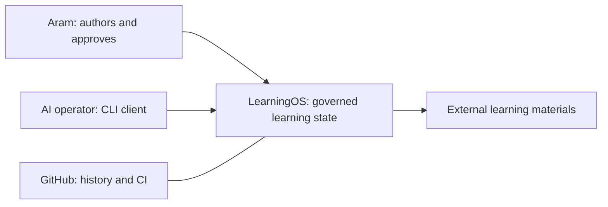
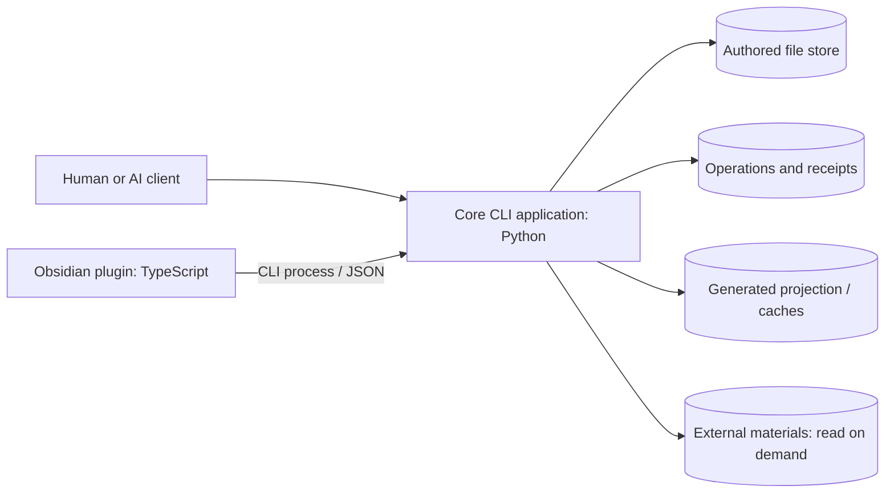
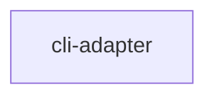
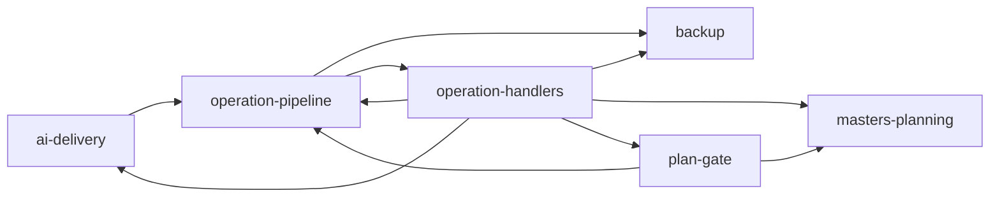
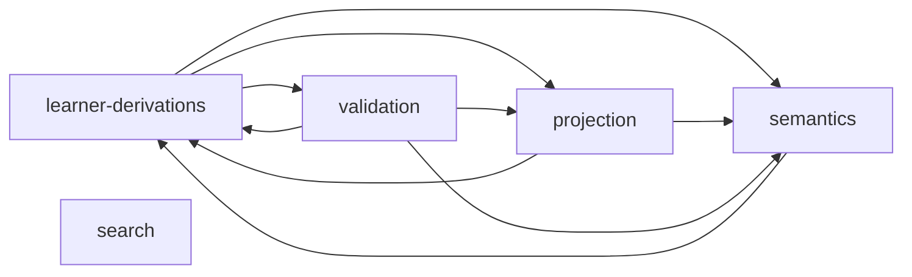
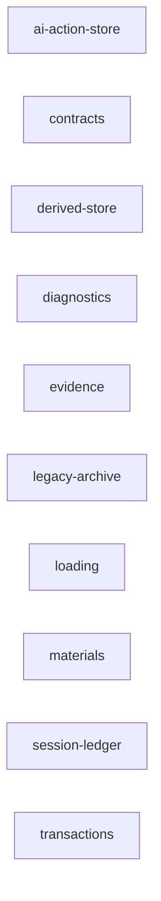
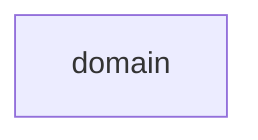

# Architecture views

These Mermaid flowcharts use C4 levels of abstraction. Applications and data
stores form runtime boundaries; Python packages are components inside Core.

## System context

## Containers and stores

The `learning_os` package executes inside the Core process. `tools/los.py`,
`tools/generate.py`, `tools/validate.py` and `tools/seal_envelope.py` are process
entry points into that package, not independent deployed services. The plugin
starts Core using the vault's interpreter and script. Generated views and caches
are disposable; authored files and committed receipts are durable.

## Component views by layer

These code-derived diagrams show imports within each layer. The printed layer
order defines the permitted downward direction between layers. Package-root is
documented separately because it is outside that layers contract.

<!-- system-map:begin name=components -->
Layer order (from pyproject.toml): adapters → app → derive → store → domain.

### adapters

### app

### derive

### store

Component roster: 30 intra-layer imports omitted here for readability. Each component page lists its complete dependencies.

### domain

<!-- system-map:end -->
