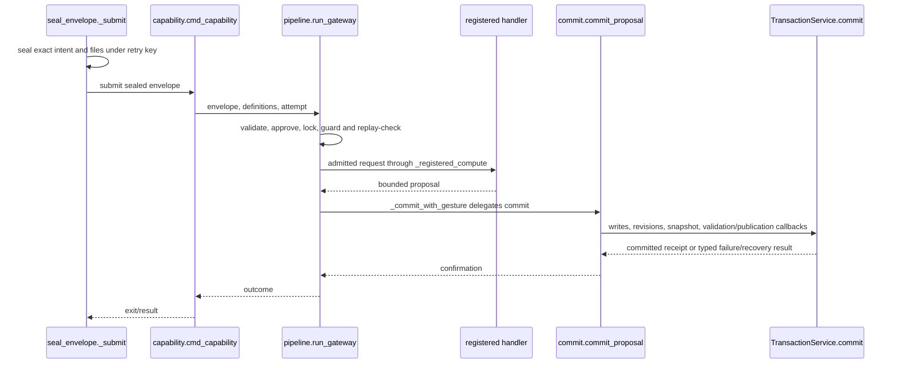
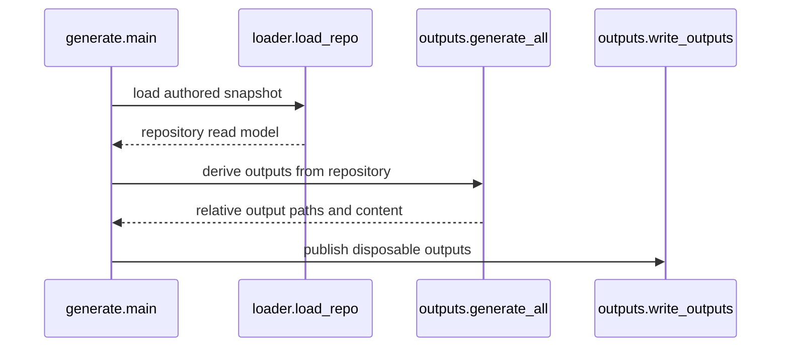
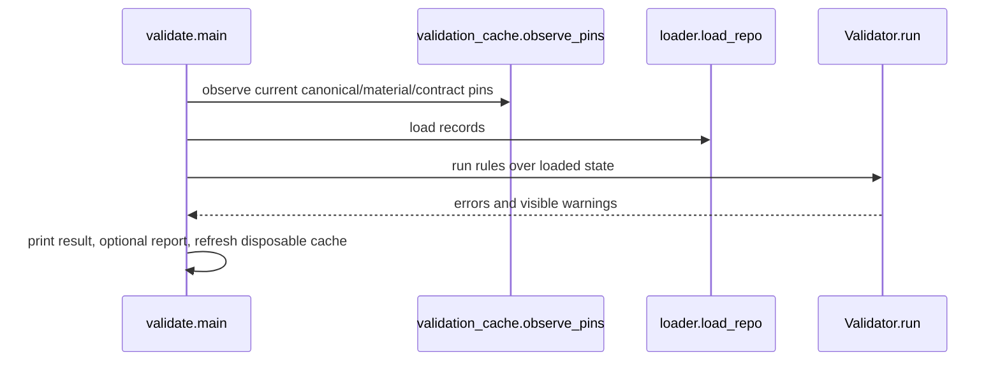
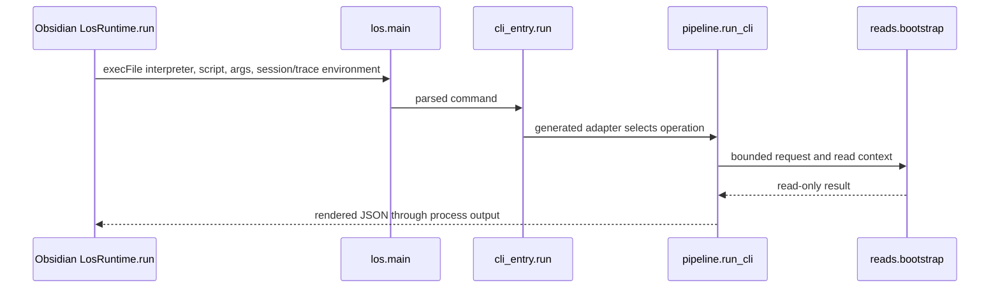

# Four execution flows

These traces were checked against the code at the change's base. The map checker
checks Python symbol existence; it does not prove runtime execution or every
branch. Refusals, replay, check-only mode and recovery remain covered by their
own tests. Sequence participant labels describe responsibilities.

<!-- system-map:external Obsidian-LosRuntime.run -->

## Sealed canonical write

<!-- system-map:participant S tools/seal_envelope.py::_submit -->
<!-- system-map:participant A tools/learning_os/adapters/capability.py::cmd_capability -->
<!-- system-map:participant P tools/learning_os/app/pipeline.py::run_gateway -->
<!-- system-map:participant H component:operation-handlers -->
<!-- system-map:participant C tools/learning_os/app/commit.py::commit_proposal -->
<!-- system-map:participant T tools/learning_os/store/transactions.py::TransactionService.commit -->

<!-- system-map:symbol tools/seal_envelope.py::_submit -->
<!-- system-map:symbol tools/learning_os/adapters/capability.py::cmd_capability -->
<!-- system-map:symbol tools/learning_os/app/pipeline.py::run_gateway -->
<!-- system-map:symbol tools/learning_os/app/pipeline.py::_registered_compute -->
<!-- system-map:symbol tools/learning_os/app/commit.py::commit_proposal -->
<!-- system-map:symbol tools/learning_os/store/transactions.py::TransactionService.commit -->

Exact replay returns before recomputing the handler. Check mode validates a
shadow proposal instead of committing. A durable receipt marks the commit
boundary. Receipt-publication uncertainty preserves forward state and the
journal for reconciliation; later bookkeeping failure does not undo a commit.

## Generate disposable views

<!-- system-map:participant G tools/generate.py::main -->
<!-- system-map:participant L tools/learning_os/store/loading/__init__.py::load_repo -->
<!-- system-map:participant B tools/learning_os/derive/projection/outputs.py::generate_all -->
<!-- system-map:participant W tools/learning_os/derive/projection/outputs.py::write_outputs -->

<!-- system-map:symbol tools/generate.py::main -->
<!-- system-map:symbol tools/learning_os/store/loading/__init__.py::load_repo -->
<!-- system-map:symbol tools/learning_os/derive/projection/outputs.py::generate_all -->
<!-- system-map:symbol tools/learning_os/derive/projection/outputs.py::write_outputs -->

Generation is not an alternative canonical writer. Errors refuse publication
instead of silently omitting unreadable state.

## Offline validation

<!-- system-map:participant V tools/validate.py::main -->
<!-- system-map:participant P tools/learning_os/store/validation_cache.py::observe_pins -->
<!-- system-map:participant L tools/learning_os/store/loading/__init__.py::load_repo -->
<!-- system-map:participant C tools/learning_os/derive/validation/core.py::Validator.run -->

<!-- system-map:symbol tools/validate.py::main -->
<!-- system-map:symbol tools/learning_os/store/validation_cache.py::observe_pins -->
<!-- system-map:symbol tools/learning_os/derive/validation/core.py::Validator.run -->

Warning-baseline comparison is a separate gate. A validation cache is auxiliary
and cannot turn a new observation into an earlier trusted result.

## UI read through the public process boundary

<!-- system-map:participant U external:Obsidian-LosRuntime.run -->
<!-- system-map:participant L tools/los.py::main -->
<!-- system-map:participant A tools/learning_os/adapters/cli_entry.py::run -->
<!-- system-map:participant P tools/learning_os/app/pipeline.py::run_cli -->
<!-- system-map:participant H tools/learning_os/app/handlers/reads.py::bootstrap -->

<!-- system-map:symbol tools/los.py::main -->
<!-- system-map:symbol tools/learning_os/adapters/cli_entry.py::run -->
<!-- system-map:symbol tools/learning_os/app/pipeline.py::run_cli -->
<!-- system-map:symbol tools/learning_os/app/handlers/reads.py::bootstrap -->

The UI boundary was traced in sibling `src/infrastructure/los-runtime.ts` at
UI `f7dbc1f`. This Core-only checker does not validate TypeScript symbols.
The read shown is an example; it does not claim every UI read is bootstrap.
