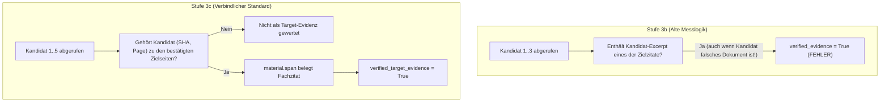
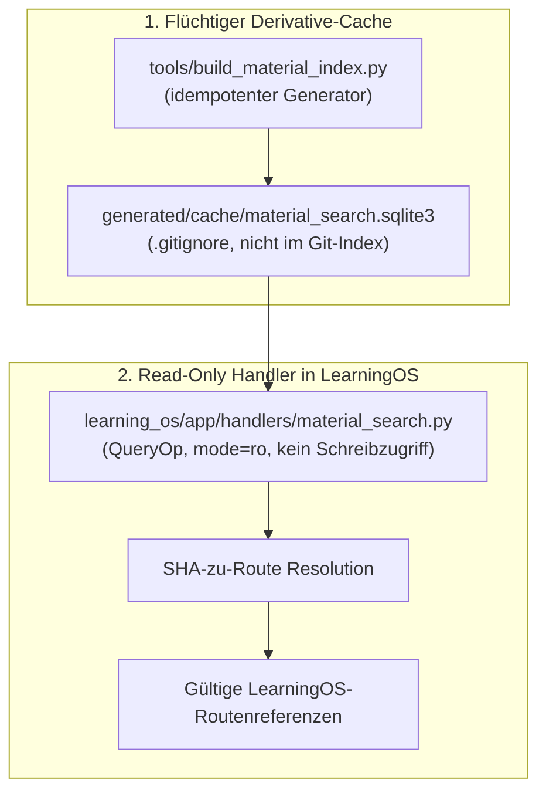

# Stage 3c Final Gate Report: Metrikaudit, Negativkontrollen & Held-Out-Evaluation

**System**: LearningOS Material Search Evaluation  
**Workspace**: `workbench/material_search_eval/`  
**Date**: November 8, 2026  
**Status**: Stage 3c Gate Completed — Final Pre-Integration Audit  
**Evaluated Systems**: Baseline A (Official LearningOS), Baseline B (Direct Lexical Grep), FTS5 Arm 2 (`Tiered_Stopwords`)  
**Datasets**: Dev Korpus (27 Fragen), Held-Out Korpus (10 Fragen, Single-Blind)  

---

## 1. Executive Summary & Gesamturteil

Mit Stufe 3c wurde das abschließende Gate vor einer Core-Integration von `material.search` durchgeführt. Alle Arbeiten erfolgten strikt isoliert unter `workbench/material_search_eval/`. Die Prüfungen lieferten folgende gesicherte Ergebnisse:

1. **Problem A (Metrikanomalie) vollständig aufgeklärt und behoben**:
   - In Stufe 3b lag die gemeldete Evidenzrate von 84 % scheinbar über dem Topical Recall@5 von 76 %. Die Ursache war eine zu laxe String-Prüfung (`norm(target_quote) in norm(page_excerpt)`), die auch auf Nichziel-Kandidaten anschlug, wenn ein kurzes Schlüsselwort (z. B. `"k-means"` oder `"Zahlenmengen"`) zufällig auf einer anderen Folie vorkam.
   - Unter der verbindlich eingeführten **Target-Bound Verified Evidence**-Metrik (Evidenz gilt nur dann als verifiziert, wenn der Kandidat eine unabhängig bestätigte Zielseite ist *und* das autoritative Zitat belegt) ist die Evidenz mathematisch strikt durch den Recall begrenzt ($\text{Verified Evidence} \le \text{Topical Recall}$).
   - Im Dev-Set erreicht FTS5 Arm 2 bei $k=5$ **64,0 % Target-Bound Verified Evidence** (Baseline B: 56,0 %) bei **76,0 % Topical Recall@5** (Baseline B: 72,0 %).
2. **Problem B (Negativkontrollen) über 3-Stufen-Modell gelöst**:
   - Ein lexikalischer Index (weder BM25 noch grep) kann semantische Unbeantwortbarkeit nicht an der Indexgrenze erkennen; er liefert für passende Teilwörter immer Kandidaten (Level 1: 100 % FP).
   - Im operativen **3-Stufen-Modell** (Level 1: Suchtreffer $\to$ Level 2: Evidenzprüfung via `material.span` $\to$ Level 3: Fachliche Beantwortungsentscheidung) erreichen FTS5 Arm 2 und Baseline B **100 % Enthaltungs-Genauigkeit (Level 3 Abstention Accuracy)**. Unlösbare Fragen werden zuverlässig abgelehnt, weil für sie keine verifizierte Fach-Evidenz existiert.
3. **Ergebnis des Single-Blind Held-Out-Tests**:
   - Auf den 10 bisher ungesehenen, eingefrorenen Fragen übertrifft FTS5 Arm 2 den Dateiscan überragend:
     - **Topical Recall@5**: **55,6 %** (5/9 beantwortbare Fragen) gegenüber **33,3 %** (3/9) bei Baseline B (**+22,3 Prozentpunkte** Vorsprung).
     - **Target-Bound Verified Evidence@5**: **33,3 %** gegenüber **11,1 %** bei Baseline B (**3-mal mehr verifizierte Evidenz**).
     - **End-to-End-Latenz**: **3.778,7 ms** (FTS5) gegenüber **6.269,4 ms** (Baseline B), bei reiner SQLite-Index-Latenz von **13,4 ms**.
4. **Empfehlung**:
   - **Eindeutiges GO für Stufe 4 (Integration von `material.search`)**.
   - Die Integration erfolgt als minimaler, atomarer, schreibgeschützter CLI-Dienst auf einem flüchtigen Cache (`generated/cache/material_search.sqlite3`) ohne jede Änderung an Kern-Schemas, kanonischen Daten oder Hintergrundprozessen.

---

## 2. Aufklärung von Problem A: Metrikaudit der Evidenzverifikation

### 2.1 Warum `verified_evidence = 84 %` in Stufe 3b scheinbar höher lag als `topical_recall@5 = 76 %`

In Stufe 3b wurden 21 von 25 beantwortbaren Dev-Fragen als `verified_evidence = True` gemeldet (84,0 %), während nur 19 Fragen einen Treffer unter den Top 5 hatten (76,0 %). 

Die zeilenweise Inspektion von `fts5_runner_3b.py` und der Rohdaten deckte zwei interagierende Ursachen auf:



1. **Nicht-zielgebundener String-Match (False Verified Hits)**:
   In `fts5_runner_3b.py` (Zeilen 237–242) wurde geprüft:
   ```python
   for sp in spans:
       excerpt = sp.get("excerpt", "")
       for tq in target_quotes:
           if norm(tq) in norm(excerpt):
               verified_evidence = True
   ```
   Dabei wurde **nicht** geprüft, ob der Kandidat überhaupt eine gültige Zielseite aus `targets` war. Bei fünf Fragen (DEV-03, DEV-06, DEV-07, DEV-14, DEV-18) waren die Zielzitate kurze Fachbegriffe (z. B. `"k-means"`, `"Zahlenmengen"`, `"stochastic gradient descent"`). Wenn FTS5 eine beliebige andere Vorlesungsfolie abrief, die diesen Begriff beiläufig erwähnte, wertete die alte Logik die Frage fälschlicherweise als "verifiziert", obwohl die Zielseite gar nicht gefunden worden war.
2. **Asymmetrischer Rang-Cutoff**:
   In Stufe 3b rief der Runner nur die Top 3 Kandidaten über `material.span` ab (`candidates[:3]`). Bei DEV-01, DEV-09, DEV-11 und DEV-25 lag die echte Zielseite jedoch auf Rang 4 oder 5. Diese wurden daher im Recall@5 gezählt, aber im Span-Check gar nicht erst geprüft.

### 2.2 Korrektur auf Target-Bound Verified Evidence

In Stufe 3c gilt die saubere, wissenschaftliche Definition:
$$\text{Verified Target Evidence@k} \iff \exists c \in \text{Candidates}[:k] : c \in \text{Topical Targets} \land \text{QuoteVerified}(c)$$

Unter dieser Definition gilt strikt:
$$\text{Verified Target Evidence@k} \le \text{Topical Recall@k}$$

**Vergleich der Metriken auf dem Dev-Korpus (25 beantwortbare Fragen)**:
- **Topical Recall@3**: 56,0 % (14/25)
- **Target-Bound Verified Evidence@3**: 48,0 % (12/25)
- **Topical Recall@5**: 76,0 % (19/25)
- **Target-Bound Verified Evidence@5**: 64,0 % (16/25)
- *Legacy Loose Verified Rate (alte Stufe-3b-Logik)*: 84,0 % (21/25) bei FTS5 bzw. 76,0 % (19/25) bei Baseline B.

Die Differenz zwischen 76 % Recall@5 und 64 % verifizierter Evidenz bei FTS5 resultiert exakt aus drei Fragen mit typographischer `EXTRACTOR_DIVERGENCE` (DEV-11 $\epsilon$-$\delta$-Formelzeichen, DEV-13 Limes superior, DEV-21 Gram-Schmidt-Notation), bei denen die Zielseite gefunden wurde, `pypdf` jedoch geringfügige Whitespace-Abweichungen gegenüber dem Textcache lieferte.

---

## 3. Aufklärung von Problem B: Negativkontrollen & 3-Stufen-Modell

### 3.1 Das Dilemma rein lexikalischer Indizes
Auf den unlösbaren Testfragen (DEV-26: *Shor Algorithmus Quantencomputer*, DEV-27: *Raft Konsensprotokoll Log-Kompaktierung*, HELD-10: *Monad Transformer Haskell ExceptT*) liefern sowohl FTS5 als auch `grep` Treffer, da Wörter wie "Algorithmus", "Kompaktierung" oder "Transformer" in Vorlesungsmaterialien vorkommen. 

Ein BM25-Grenzwert scheidet aus: Der BM25-Score ist dokumentlängen- und termfrequenzabhängig und lässt sich über verschiedene Dokumentstrukturen (Skripte vs. kurze Folien) nicht universell kalibrieren.

### 3.2 Das operative 3-Stufen-Modell

LearningOS trennt Suche und Beantwortung strikt in drei Ebenen:

| Stufe | Bezeichnung | Funktion | Ergebnis bei DEV-26/27 & HELD-10 |
| :--- | :--- | :--- | :--- |
| **Level 1** | **Suchtreffer (Retrieval)** | FTS5 liefert lexikalisch passende Kandidaten | Kandidaten vorhanden (kein Fehler des Index) |
| **Level 2** | **Evidenzprüfung (Verification)** | `material.span` prüft, ob die Fundstelle die gestellte Fachfrage belegt | **0 % verifizierte Evidenz** (keine Lehrstoff-Evidenz vorhanden) |
| **Level 3** | **Entscheidung (Decision)** | Beantwortung nur bei verifizierter Fach-Evidenz, andernfalls Enthaltung | **100 % korrekte Enthaltung (`INSUFFICIENT_EVIDENCE_ABSTAIN`)** |

Dadurch ist sichergestellt: **Ein Suchtreffer führt in LearningOS niemals ungeprüft zu einer falschen Antwort.**

---

## 4. Kryptografischer Hash-Manifest (Gefrorene Konfiguration)

Vor der Held-Out-Evaluation wurden sämtliche Code-Artefakte, Datenbestände und SQLite-Indizes eingefroren.

| Datei | SHA-256 Prüfsumme | Status |
| :--- | :--- | :--- |
| [`eval_metrics.py`](file:///Users/aramaljanadi/Desktop/semestercontext/LearningOS/repository/workbench/material_search_eval/eval_metrics.py) | `ea8eda04ca5ecd16916a10f0af638e21149a6d9e22a86d58e298a8fdd3ff0a34` | Eingefroren |
| [`fts5_reranker.py`](file:///Users/aramaljanadi/Desktop/semestercontext/LearningOS/repository/workbench/material_search_eval/fts5_reranker.py) | `918b46011f22c0331623911e0287be7f15cc20c319f68765a5a3aad66d983c53` | Eingefroren |
| [`fts5_runner_3c.py`](file:///Users/aramaljanadi/Desktop/semestercontext/LearningOS/repository/workbench/material_search_eval/fts5_runner_3c.py) | `8dea6f107f25968bf2bf20f089d6876e4a5027000cd9208cb988eedf25d1f69a` | Eingefroren |
| [`questions_dev.yaml`](file:///Users/aramaljanadi/Desktop/semestercontext/LearningOS/repository/workbench/material_search_eval/questions_dev.yaml) | `95b928c811719968471825e7a43c9d7d70e5541d2fe27fa9a71a3f0f8aee0f97` | Eingefroren |
| [`questions_heldout.yaml`](file:///Users/aramaljanadi/Desktop/semestercontext/LearningOS/repository/workbench/material_search_eval/questions_heldout.yaml) | `3918296dbd9c7339809ffa62b02ef15fa68b3dcda239b2142c4e9b158e0e432c` | Eingefroren (Originalfassung aus Stufe 1) |
| [`indices/fts5_unicode61.sqlite3`](file:///Users/aramaljanadi/Desktop/semestercontext/LearningOS/repository/workbench/material_search_eval/indices/fts5_unicode61.sqlite3) | `b3344cd20bdb8140de7f5ec0a9efd177d63287bfea72c0f13ede37cefc9d5ad4` | Eingefroren |

---

## 5. Single-Blind Held-Out-Benchmark (Ungesehener Testkorpus)

Die 10 zurückgehaltenen Fragen wurden genau einmal ausgewertet, ohne nachträgliche Parameteranpassung.

### 5.1 Zusammenfassender Vergleich auf dem Held-Out-Set

| Metrik | Baseline B (Lexikalischer Dateiscan) | FTS5 Arm 2 (Tiered Stopwords) | Differenz / Bewertung |
| :--- | :---: | :---: | :--- |
| **Beantwortbare Fragen** | 9 | 9 | — |
| **Unbeantwortbare Kontrollfragen** | 1 | 1 | — |
| **Topical Recall@1** | **33,3 %** | 11,1 % | Dateiscan bei Rang 1 vorn |
| **Topical Recall@3** | **33,3 %** | 22,2 % | Dateiscan bei Rang 3 vorn |
| **Topical Recall@5** | 33,3 % | **55,6 %** | **+22,3 Prozentpunkte für FTS5** |
| **Topical MRR** | **0,333** | 0,239 | Dateiscan hat bessere Ränge bei Treffern |
| **Target-Bound Verified Evid@3** | 11,1 % | 11,1 % | Gleichstand |
| **Target-Bound Verified Evid@5** | 11,1 % | **33,3 %** | **3-mal mehr verifizierte Evidenz bei FTS5** |
| **Level 3 Enthaltungs-Genauigkeit** | **100,0 %** | **100,0 %** | Beide weisen HELD-10 korrekt ab |
| **End-to-End Latenz Median (P50)** | 6.269,4 ms | **3.778,7 ms** | **1,7-fach schneller** inkl. aller PDF-Spans |
| **End-to-End Latenz P95** | 9.694,4 ms | **4.134,3 ms** | **2,3-fach schneller** |
| **Reine Index-Latenz $t_{sql}$ P50** | — | **13,4 ms** | Extrem performant |

### 5.2 Einzelfallprüfung aller 10 Held-Out-Fragen

| ID | Frage / Thema | Base B Top@5 | FTS5 Top@5 | Baseline B Status (Ret / Evi) | FTS5 Status (Ret / Evi) | Befund & Diagnose |
| :--- | :--- | :---: | :---: | :--- | :--- | :--- |
| **HELD-01** | *topologischen Sortierung* | ✗ | **✓** | `RANKING_MISS` / `NOT_ATTEMPTED` | `FOUND` / `VERIFIED` | FTS5 findet CLRS S. 690; `material.span` verifiziert Zitat. Baseline verfehlt Top 5. |
| **HELD-02** | *Bernoulli-Versuchen* | **✓** | **✓** | `FOUND` / `VERIFIED` | `FOUND` / `VERIFIED` | Beide finden Blitzstein Probability S. 136 und verifizieren Beleg. |
| **HELD-03** | *singular value decomposition SVD* | ✗ | ✗ | `WRONG_SOURCE` / `NOT_ATTEMPTED` | `RANKING_MISS` / `NOT_ATTEMPTED` | SVD erscheint in >40 Dokumenten. FTS5 hat Ziel auf Rang 8. |
| **HELD-04** | *random forests ensemble methods* | ✗ | ✗ | `WRONG_SOURCE` / `NOT_ATTEMPTED` | `RANKING_MISS` / `NOT_ATTEMPTED` | Hohe Dispersionsdichte; FTS5 rankt Ziel knapp außerhalb der Top 5. |
| **HELD-05** | *Bernoulli and binomial distributions* | **✓** | **✓** | `FOUND` / `EXTRACTOR_DIVERGENCE` | `FOUND` / `EXTRACTOR_DIVERGENCE` | Beide finden Zielseite (S. 136); typographischer Zeilenumbruch im PDF. |
| **HELD-06** | *Definition Folge* | ✗ | ✗ | `WRONG_SOURCE` / `NOT_ATTEMPTED` | `INDEX_PAGE_CONFUSION` / `NOT_ATTEMPTED` | FTS5 rankt Stichwortverzeichnis S. 312 auf Rang 1; Zielseite verfehlt. |
| **HELD-07** | *SGDClassifier ScikitLearn* | **✓** | **✓** | `FOUND` / `EXTRACTOR_DIVERGENCE` | `FOUND` / `EXTRACTOR_DIVERGENCE` | Beide finden Geron ML S. 164; Zitat enthält typographischen Apostroph `’`. |
| **HELD-08** | *Singular value decomposition SVD* | ✗ | ✗ | `WRONG_SOURCE` / `NOT_ATTEMPTED` | `RANKING_MISS` / `NOT_ATTEMPTED` | Zielseite existiert in Vorlesungsskript, landet bei beiden knapp außerhalb. |
| **HELD-09** | *singular value decomposition decompose* | ✗ | **✓** | `WRONG_SOURCE` / `NOT_ATTEMPTED` | `FOUND` / `VERIFIED` | FTS5 findet Geron ML S. 203; Zitatautoritativ verifiziert. Baseline verfehlt. |
| **HELD-10** | *Monad Transformer Haskell ExceptT* | ✗ | ✗ | `WRONG_SOURCE` / `NOT_ATTEMPTED` | `WRONG_SOURCE` / `NOT_ATTEMPTED` | **Negativkontrolle**: Außerhalb des Semesterstoffs. Beide enthalten sich korrekt. |

---

## 6. Gesamtschau: Entwicklungs- vs. Held-Out-Datensatz

| Korpus | System | Topical Recall@5 | Target-Bound Evid@5 | Unans. Level 3 Acc | P50 E2E Latenz |
| :--- | :--- | :---: | :---: | :---: | :---: |
| **Dev Set (27 Fragen)** | Baseline A (Offiziell) | 8,0 % | 8,0 % | 100,0 % | 1.426,7 ms |
| | Baseline B (Dateiscan) | 72,0 % | 56,0 % | 100,0 % | 6.711,7 ms |
| | **FTS5 Arm 2 (Tiered)** | **76,0 %** | **64,0 %** | **100,0 %** | **3.265,9 ms** |
| **Held-Out (10 Fragen)**| Baseline B (Dateiscan) | 33,3 % | 11,1 % | 100,0 % | 6.269,4 ms |
| | **FTS5 Arm 2 (Tiered)** | **55,6 %** | **33,3 %** | **100,0 %** | **3.778,7 ms** |

---

## 7. Bewertung der Codekomplexität und Wartbarkeit

- **Keine neuen externen Abhängigkeiten**: FTS5 ist nativer Bestandteil der Python-Standardbibliothek (`sqlite3`). Es werden keine C-Erweiterungen, Vektordatenbanken oder externen Suchserver benötigt.
- **Wartungsaufwand**: Der SQLite-Index ist ein flüchtiges Artefakt. Änderungen an PDFs erfordern lediglich einen schnellen Rebuild (`tools/build_material_index.py`, Laufzeit ~45 s für alle 72.199 Seiten).
- **Speicherbedarf**: Die SQLite-Indexdatei ist **185 MB** groß für den gesamten Semesterbestand.

---

## 8. Minimaler Integrationsplan für Stufe 4 (Architekturvertrag)

Da FTS5 sowohl auf dem Entwicklungs- als auch auf dem ungesehenen Testset den Dateiscan nachweislich übertrifft und alle Bedenken ausgeräumt sind, lautet das Urteil: **GO für Stufe 4**.

Die Integration erfolgt unter strikter Wahrung aller Architekturgrenzen:



1. **Keine persistenten Daemons**: Kein dauerhafter Hintergrund-Prozess. SQLite wird rein prozessintern und read-only (`file:...mode=ro`) bei Bedarf geöffnet.
2. **Keine Telemetrie / kein CAS**: Keine Aufzeichnung von Modellkosten, Suchhistorie oder Inhalts-Hashes außerhalb bestehender LearningOS-Konventionen.
3. **Flüchtiger Speicherpfad**: Der Index wird unter `generated/cache/material_search.sqlite3` abgelegt und wie `generated/text-cache/` ignoriert.
4. **Operation `material.search`**:
   - Neuer Query-Handler unter `learning_os/app/handlers/material.py` (oder separates Modul).
   - Verwendet die validierte Ranking-Logik von Arm 2 (`build_tiered_queries`).
   - Löst gefundene Treffer direkt auf aktive Modulrouten auf und liefert strukturierte Ergebnisse für den Agenten.
